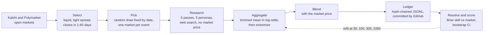

# Oracle

Oracle is an AI forecaster that is scored against prediction markets. Every day it picks a few
open yes/no questions from Kalshi and Polymarket, has a language model research each one on the
web and estimate the probability, and writes the forecast to a tamper-evident log **before** the
outcome is known. When a question resolves, Oracle's probability and the market's price are
scored against what happened. The question it tries to answer: can an LLM with web search beat
the price set by people betting real money? It trades on paper only; there is no code that
places an order.

## Live results

**https://mahir-patel.github.io/Oracle/**

The page is rebuilt by a GitHub Actions run every day at 06:17 UTC. It shows the score so far,
every forecast with the model's reasoning, and how to check the record. The first forecasts
were logged on 2026-11-16, so the record is young: the page says "not enough resolved questions
yet" until 10 have resolved, and makes no claim about beating the market below 200.

## How it works



| Module | Job |
|---|---|
| `markets.py` | Kalshi and Polymarket clients: open markets, fees, results |
| `pipeline.py` | market selection, the daily pick, question-to-forecast glue |
| `prompts.py`, `agent.py` | the system prompt, five personas, the search agent, cost tracking |
| `aggregate.py`, `calibrate.py` | log-odds math, extremizing, market blend, gated isotonic calibrator |
| `sizing.py` | venue fees, edge, fractional Kelly paper bets, P&L |
| `ledger.py` | append-only, hash-chained log |
| `scoring.py`, `report.py` | Brier, skill vs market, bootstrap, calibration, the public page |
| `simulate.py` | an offline synthetic world used to test the whole pipeline |
| `cli.py` | the `oracle` command |

## Design decisions and findings

### Leakage and the model cutoff

A forecast is only worth something if it could not have used the answer. Live forecasting with
web search is safe by construction: the web holds only the past. Backtests are not, because the
model may remember outcomes from its training data. So any question that resolved before the
model's training cutoff (`MODEL_CUTOFF`, 2026-07-01) is excluded from every score and every
fit. The report also runs a contamination check: if the Brier score on pre-cutoff questions is
below 0.75 times the score on post-cutoff ones, it prints a warning, because that pattern looks
like memory, not skill.

### The agent never sees the market price

The price is the single most informative number about any of these questions, which is exactly
why the model is not shown it. A model that sees 23% will anchor on 23%, and its answer stops
being an independent signal. Oracle forms its view blind, and the blend with the market happens
afterwards in code: `sigmoid((1 - w) * alpha * logit(model) + w * logit(market))`, with the
weight `w` fitted on resolved questions. The search tool is also blocked from `kalshi.com` and
`polymarket.com`, since a search for the question title would otherwise land on a page showing
the live price.

### Personas instead of temperature

An ensemble needs its members to disagree for a reason. Each of the five passes gets a
different angle: outside view (base rates), inside view (current evidence), devil's advocate,
resolution lawyer (the exact wording of the rules) and status quo. That gives diversity that
can be read and audited afterwards, where sampling temperature gives diversity that is just
noise. It was also the only option on the model this was first built for, whose API rejects
sampling parameters.

### Aggregating in log-odds

The five estimates are averaged as log-odds, not as probabilities, after trimming the highest
and lowest 20%. In probability space, 1% and 10% are nine points apart and so are 45% and 54%,
but the first pair is a tenfold difference in odds and the second is nothing. Log-odds treat
evidence additively, which is what combining independent views requires. The spread of the five
logits is logged with every forecast as `disagreement`.

### Extremizing: the main result of the simulation

LLMs hedge toward 50%, and averaging several hedged answers hedges further. Extremizing undoes
this: `sigmoid(alpha * logit(p))` with `alpha > 1` pushes the average away from 50%.

The offline simulation builds a synthetic world (true probabilities, a noisy market, a hedging
fake agent), runs it through the real pipeline and ledger, fits `alpha` and `w` on the first
600 questions and scores the next 600. Acceptance was fixed in advance over five seeds, never a
hunt for one that passes:

| seed | alpha | w | final Brier | model only | market | skill vs market | 95% CI |
|---|---|---|---|---|---|---|---|
| 7 | 1.60 | 0.30 | 0.1827 | 0.1828 | 0.1930 | +0.053 | +0.021 to +0.087 |
| 8 | 1.40 | 0.35 | 0.1776 | 0.1792 | 0.1855 | +0.042 | +0.007 to +0.077 |
| 9 | 1.05 | 0.60 | 0.1993 | 0.1957 | 0.2077 | +0.040 | +0.025 to +0.055 |
| 10 | 1.45 | 0.00 | 0.1899 | 0.1899 | 0.1947 | +0.025 | -0.027 to +0.075 |
| 11 | 1.35 | 0.25 | 0.1748 | 0.1779 | 0.1782 | +0.019 | -0.023 to +0.059 |

Pooled over all five (3,000 out-of-sample questions): skill **+0.036, 95% CI +0.020 to
+0.052**. Three honest readings of that table:

- Almost all the gain comes from extremizing. The fitted `alpha` is above 1 in every seed.
- The market blend adds very little (mean Brier 0.1849 with it, 0.1851 without), and the fitted
  weight swings from 0.00 to 0.60 across seeds. At this sample size it is not a stable number.
- Three of the five seeds fail on their own. Seed 9's blend made things worse, and seeds 10 and
  11 have intervals that include zero. With 600 questions, a real 2 to 5% edge is invisible two
  times in five. The live record will have the same problem, which is why the page refuses to
  claim anything below 200 resolved questions, and why even that bar is generous.

This is a simulation of a made-up world. It shows the pipeline works and what sample size the
question needs. It says nothing about whether the real model beats real markets.

### Isotonic calibration made things worse

A second, more flexible calibrator (isotonic regression) stacked on top of the fitted `alpha`
looked like a free improvement. It was not. Delta is the Brier score with the calibrator minus
without it, over the next 5,000 questions; positive means the calibrator hurt:

| training size | mean delta | seeds where it got worse |
|---|---|---|
| 300 | +0.00118 | 4 of 5 |
| 600 | +0.00034 | 4 of 5 |
| 1000 | +0.00044 | 5 of 5 |
| 3000 | +0.00021 | 4 of 5 |

Two calibrators in a row overfit: the second one fits noise the first left behind. The harm
shrinks with more data but never turns into a gain. So the calibrator is gated: it is the
identity function below 1,000 resolved forecasts. One caveat: in the simulated world the
miscalibration is exactly the kind `alpha` fixes, so isotonic had nothing left to correct. Real
model errors may be different, and the gate is a judgement call, not a derived number.

### The ledger: a hash chain plus someone else's clock

Each line of `data/ledger.jsonl` is one record in canonical JSON, carrying the SHA-256 hash of
the line before it. Change or delete any old forecast and every later hash stops matching.
`verify` is stricter than a plain chain check: each line must be byte-for-byte canonical, so an
edit that parses to the same values still fails.

A hash chain alone has two holes. The owner could rebuild the whole chain from scratch, and
could quietly drop the newest entries, since nothing comes after them to break. Both are closed
by git: the daily run commits the ledger from GitHub Actions, so GitHub's servers, not this
project, record when each line first appeared.

### Smaller decisions worth knowing

- **Random, pre-committed question choice.** The daily pick is a shuffle seeded by the UTC
  date, with quotas by time to close (most picks close within two weeks) and at most one
  market per event. Nobody, including the author, can steer it toward easy questions, and
  markets that resolve together are not counted as independent evidence.
- **Fees are real.** Both venues charge takers `rate * contracts * P * (1 - P)`. Paper bets pay
  it, so paper P&L is net of fees. Polymarket is no longer fee-free, whatever older write-ups
  say; the rate comes from each market's own data.
- **Hard spending caps.** A per-run cap, a lifetime cap, and a check before each question that
  the remaining budget covers it.

## How to verify the track record

```bash
git clone https://github.com/mahir-patel/Oracle.git
cd Oracle
pip install .
oracle verify
```

`oracle verify` recomputes the whole chain and exits with an error if any line was altered. To
check *when* forecasts were made, read the history of the file:

```bash
git log --format='%H %cI' -- data/ledger.jsonl
```

Each daily commit is made by GitHub Actions. A forecast's `ts` should fall just before the
commit that introduced it, and before the market's `close_time`.

## Run it yourself

Requires Python 3.12.

```bash
pip install -e ".[dev]"
pytest -q                 # 233 tests, none touch the network
oracle simulate --n 1200 --seed 7   # the offline world, no API key needed
oracle report             # rebuild data/report.json and docs/index.html
```

Live forecasting needs an Anthropic API key in the environment and spends real money:

```bash
export ANTHROPIC_API_KEY=...
oracle forecast --max 5   # pick, research, log
oracle resolve            # look up results of markets that have closed
```

Every setting lives in `forecaster/config.py` and can be overridden with an `ORACLE_` variable,
for example `ORACLE_MAX_SPEND_PER_RUN=0.50`. To run it daily on your own fork, add the key as
the repository secret `ANTHROPIC_API_KEY` and enable Pages on the `docs` folder; the workflow in
`.github/workflows/daily.yml` does the rest.

## Costs

Measured, not estimated:

| Model | Setup | Cost per question |
|---|---|---|
| Claude Fable 5.2 | 5 passes, 4 searches each | about $5.50 |
| Claude Haiku 5.5 | 5 passes, 3 searches each | about $0.145 |

The project was specified for the larger model. One live question showed where the money goes:
a single pass read 104,450 input tokens, almost all of it search results re-read at each step
of the search loop, and prompt caching did not apply inside that loop. At $5.50 a question, a
sample large enough to mean anything would have cost thousands of dollars. The record
therefore runs on Haiku 5.5 with a lifetime budget of $50, about 5 questions a day. On Haiku
the search fee ($0.01 per search) is most of the cost. This is a deliberate trade of forecaster
quality for sample size, and the ledger records the model on every forecast so results from
different models are never pooled.

## Limitations

- **Slow feedback.** A forecast is only scored when its market resolves, days or weeks later.
- **Small n.** The simulation shows several hundred resolved questions cannot reliably detect a
  small edge. Until then the honest answer is "not known".
- **A weaker model than intended.** Chosen for cost. A null result here would not show that
  stronger models cannot beat markets.
- **Search is unreliable.** In the first live run, several passes reported that their searches
  failed or hit a limit and fell back on background knowledge. Some large disagreements with
  the market may reflect thin evidence, not insight. Each pass's reasoning is published on the
  page so this can be seen.
- **Paper P&L flatters.** It assumes fills at the quoted price for any size: no slippage, no
  market impact, no partial fills.
- **Each question is forecast once** and never updated as news arrives.
- **Some markets are nearly decided** when picked (the filter only requires a price between 3%
  and 97%), and those teach little.
- **Venue details are approximated.** Kalshi's liquidity figure is open interest, which is not
  comparable to Polymarket's order-book depth, and Kalshi series with non-standard fees are
  charged the standard rate.
- **Not novel research.** LLM forecasting against crowds has been studied (Halawi et al. 2024,
  ForecastBench, Metaculus's AI tournaments). The contribution here is a working, verifiable,
  honestly-scored system, not a new result.

## Roadmap

Not built. Listed so the design leaves room for them:

1. **Error predictor:** a small model on ledger features (disagreement, days to close, spread,
   distance from the market) that predicts when the forecaster is wrong, used to skip or shrink
   bets.
2. **Re-forecasting:** update forecasts as news arrives, keep every version in the ledger, and
   score by time-weighted Brier.
3. **News-shock latency:** re-forecast within seconds of breaking news and measure how much of
   any edge is speed and how much is judgement.
4. **Correlated exposure:** group related markets and cap exposure per group.
5. **Category analysis:** skill per category, then stop forecasting categories with no edge.

---

Not financial advice. `SPEC.md` is the full design; `CLAUDE.md` is the running log of decisions
and measurements.
